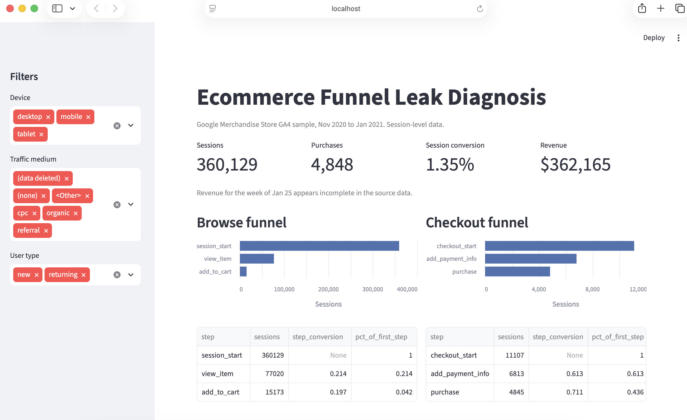

# Ecommerce Funnel Leak Diagnosis and Experiment Proposal

Diagnosing where shoppers drop out of the Google Merchandise Store purchase funnel, why they drop out, and which fix is worth testing first.

[Full findings](docs/findings.md) · [Experiment proposal](docs/experimentproposal.md) · [Executive memo](docs/memo.md)



## Business question

Where are users dropping out of the purchase funnel, why are they dropping out, and what is the single highest-value fix to test with an A/B experiment?

## Key findings

- **First-time visitors stall at payment.** New users who reach checkout add payment information at 43.9%, against 81.6% for all other users. The gap holds on every device and every checkout entry type.
- **Lost checkouts are mostly lost purchases.** Only 4.65% of new users who abandon checkout come back and buy later in the observed window.
- **Most carts never reach checkout.** Only 39.3% of cart sessions start checkout in the same session. Same-session cart abandonment is 81.2%, uniform across devices.
- **Buyers often need several visits.** 54.6% of buyers purchase on their second session or later, so experiment metrics must be measured per user, not per session.
- **The largest weekly drop was seasonal, not a defect.** Conversion fell from 1.64% to 1.06% in the week of Dec 21. Rate effects explain nearly all of the drop, and every pre-checkout step declined while checkout completion held steady.

## Recommendation

Run a 6-week A/B test of express wallet payment options for first-time buyers at checkout.

| Element | Specification |
|---|---|
| Primary metric | Purchase within 7 days of first reaching checkout (baseline 31.79%) |
| Design | User-level randomization, 50/50 split, 5 weeks enrollment plus 7 days follow-up |
| Power | 1,551 users per arm to detect a 15% relative lift (alpha 0.05, power 0.80) |
| Estimated value | $12K to $24K in net revenue per 92 days at a 10% to 20% payment-step lift |
| Prerequisite | Fix checkout event tracking before launch |

Full design, guardrails, and decision rules are in the [experiment proposal](docs/experiment_proposal.md).

## Funnel snapshot

360,129 sessions from 270,154 users, Nov 1, 2020 to Jan 31, 2021. Session conversion is 1.35%, average order value is $74.70, and total purchase revenue is about $362K.

| Stage | Step | Sessions | Step conversion |
|---|---|---|---|
| Browse | Session start | 360,129 | |
| Browse | Product view | 77,020 | 21.4% |
| Browse | Add to cart | 15,173 | 19.7% |
| Checkout | Checkout start | 11,107 | |
| Checkout | Payment info | 6,813 | 61.3% |
| Checkout | Purchase | 4,845 | 71.1% |

## Data traps caught along the way

Several results that looked like findings turned out to be data artifacts. Each one is documented in [findings.md](docs/findings.md).

1. **A strict ordered funnel undercounted purchases by 89%.** Shipping and checkout events fired in no consistent order (62% vs 38%). The ordered funnel captured only 545 of 4,848 purchase sessions. The analysis switched to a two-stage nested funnel that retains 99.9% of purchases.
2. **46% of checkouts had no tracked add to cart.** Inspecting checkout item payloads showed that 62% of these sessions fired `begin_checkout` with no item data, yet still purchased. This points to a tracking gap on one checkout path, not missing carts.
3. **Product categories could not be linked across funnel steps.** View and cart events use different item IDs and category labels than purchase events. A category funnel would have reported zero purchases for every category, so category analysis was limited to purchase-side revenue mix.
4. **One week of revenue is unreliable.** The week of Jan 25 shows an average order value of $16.70, against $58 to $102 in every other week. It was excluded from revenue conclusions.

## Approach

| Day | Focus | Methods |
|---|---|---|
| 1 | Data setup | Flattened nested GA4 events with `UNNEST`, built session keys, ran data quality checks |
| 2 | Funnel definition | Compared ordered, unordered, and nested funnels; validated event timing |
| 3 | Segmentation | Wilson confidence intervals, two-proportion z-tests, Benjamini-Hochberg correction across 129 comparisons, stratified confound checks |
| 4 | Behavior | Time to convert with censoring control, sessions to purchase, cart abandonment, checkout payload inspection |
| 5 | Metric diagnosis | Mix vs rate decomposition of the largest weekly conversion change, plus step-level breakdown |
| 6 | Experiment design | Opportunity sizing net of later-session recapture, power analysis on a user-level metric |
| 7 | Communication | Streamlit dashboard, executive memo, README |

## Repository structure

```
.
├── app/
│   ├── dashboard.py                 Streamlit dashboard
│   └── dashboard_data.parquet       Slim session-level data for the dashboard
├── docs/
│   ├── data_notes.md
│   ├── metric_definitions.md
│   ├── findings.md                  Full findings, Days 2 to 5
│   ├── experiment_proposal.md
│   └── memo.md
├── outputs/
│   ├── figures/
│   └── tables/
├── sql/
│   ├── 01_explore.sql
│   ├── 02_events_clean.sql
│   ├── 03_quality_checks.sql
│   └── 04_session_funnel.sql
├── src/
│   ├── day2_funnel.py
│   ├── day3_segments.py
│   ├── day3_followup.py
│   ├── day4_behavior.py
│   ├── day5_diagnosis.py
│   ├── day5_steps.py
│   ├── day6_sizing_power.py
│   └── export_dashboard_data.py
├── requirements.txt
└── README.md
```

## How to reproduce

**Prerequisites:** a Google Cloud project with BigQuery enabled (the free sandbox is enough), the Google Cloud CLI, and Python 3.12 or later.

1. Authenticate and set your project:
```
   gcloud auth application-default login
   gcloud config set project YOUR_PROJECT_ID
```
2. Install dependencies:
```
   python -m venv .venv
   source .venv/bin/activate
   pip install -r requirements.txt
```
3. Create a BigQuery dataset named `funnel_project`. Replace the project ID in `sql/` and `src/` with your own.
4. Run the SQL files in the BigQuery console, in order: `02_events_clean.sql`, then `04_session_funnel.sql`. Files `01` and `03` are exploration and quality checks.
5. Run the analysis scripts from the repository root:
```
   python src/02_funnel.py
   python src/03_segments.py
   python src/03_followup.py
   python src/04_behavior.py
   python src/05_diagnosis.py
   python src/05_followup.py
   python src/06_sizing_power.py
```
6. Build and launch the dashboard locally:
```
   python src/export_dashboard_data.py
   streamlit run app/dashboard.py
```

## Data and limitations

- **Source:** [GA4 obfuscated sample ecommerce dataset](https://developers.google.com/analytics/bigquery/web-ecommerce-demo-dataset) (`bigquery-public-data.ga4_obfuscated_sample_ecommerce`), Google Merchandise Store, Nov 1, 2020 to Jan 31, 2021.
- The data is obfuscated. Some categorical values appear as placeholders such as `(data deleted)` or `<Other>`.
- `user_pseudo_id` identifies a browser, not a person. Cross-device journeys appear as separate users.
- `traffic_source` reflects first-touch acquisition, not the source of each session.
- The window covers the holiday season, so conversion rates and traffic may not represent a typical quarter.
- All opportunity estimates are comparisons or scenario projections, not causal estimates. The experiment is designed to measure the causal effect.

## Tech stack

BigQuery SQL · Python (pandas, statsmodels, matplotlib) · Streamlit · Altair

## Author

Madhumitha Katam · [GitHub](https://github.com/Madhumitha282002) · [LinkedIn](https://www.linkedin.com/in/madhumithakatam/)
